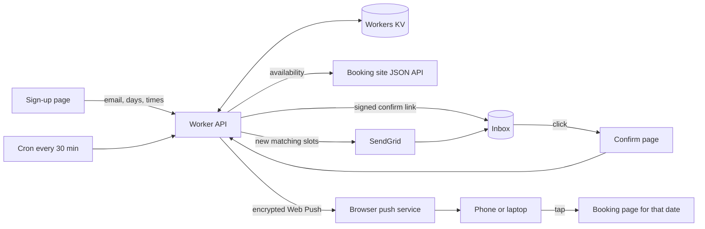

# Tennis Court Notifier

[](https://github.com/Lydia-ivee/tennis-court-notifier/actions/workflows/ci.yml)

A small Cloudflare Worker that watches court availability at Highbury tennis centre and emails you when a slot opens that matches the days and times you picked.

**Built in July 2026.** This repo was published to GitHub on 22 November 2026. The first commit dates (7 and 8 July 2026) are the files' last-modified times from when I built it, not the date it was uploaded.

## How it works



1. People sign up on a static page with their email, weekdays and hours.
2. The Worker emails a **signed confirmation link**. Nothing is saved until it is clicked (double opt-in).
3. Every 30 minutes a cron trigger asks the booking site's JSON endpoint about the next seven days, only for weekdays someone actually wants. The booking page is a single-page app, so the slots are not in its HTML and there is nothing to scrape.
4. Each subscriber hears once about each **new** matching slot. Slots already sent are remembered, so nobody gets the same alert every half hour.
5. Alerts go by email, by **instant push notification**, or both. Tapping a notification, or a slot in the email, opens the booking page for that exact date.
6. Every alert email ends with **Settings · Pause for a week · Turn off**. The settings page has an on/off switch, a one-week snooze that lapses by itself, in-place editing of days and hours, the delivery switches, and a delete button. Emails also carry one-click unsubscribe headers (RFC 8058).
7. The sign-up page shows when the courts were last checked and how many slots were open.

## Instant push alerts

The site is an installable web app (PWA) with Web Push, implemented from scratch on WebCrypto with no push library or third-party service:

- **Encryption (RFC 8291 / RFC 8188):** each notification is encrypted for one browser with a fresh ECDH key and salt, so the push service only ever carries ciphertext. The test suite reproduces the RFC's worked example byte for byte and checks interoperability against `http_ece`, the reference implementation.
- **VAPID (RFC 8292):** every request carries a short-lived ES256 JWT proving it came from this server. The subject is the site's URL, so no personal email address is sent anywhere.
- **Safe by construction:** the Worker only POSTs to an allowlist of real push services (Google, Mozilla, Apple, Microsoft), so a forged subscription cannot point it at internal URLs. The service worker only ever opens the booking site, whatever a payload says.
- **Self-cleaning:** when a push service reports a device as gone (404 or 410), the device is removed. If that leaves someone with no way to hear, email switches back on.
- **iPhone and iPad:** Safari only allows push from a home-screen app, which cannot see Safari's storage. The installed app opens at Settings and links itself with an eight-digit emailed code (hashed at rest, ten-minute expiry, one per inbox per ten minutes, guesses rate limited per address).

## Project layout

```
src/
  index.js          router and cron entry point
  subscriptions.js  sign-up, confirm, settings, push device and unsubscribe handlers
  linking.js        emailed codes that link an installed app to a subscription
  check.js          the scheduled availability check and delivery
  availability.js   London-time dates, booking API client with retry and backoff
  matching.js       pure matching, de-duplication and pause logic
  webpush.js        RFC 8291 encryption, RFC 8292 VAPID, endpoint allowlist
  devices.js        push device bookkeeping (ids, labels, pruning)
  notifications.js  what a push notification says
  email.js          email templates (HTML-escaped) and the SendGrid client
  tokens.js         HMAC-signed, purpose-bound tokens
  encoding.js       base64url and byte helpers
  validation.js     input allowlists
  http.js           JSON responses, errors, masked logging
public/             sign-up, confirm and settings pages, service worker, manifest, icons, _headers
scripts/            VAPID key generator and icon drawing script
test/               Vitest suites with an in-memory KV, stubbed fetch and real push decryption
```

## API

| Method   | Path                          | Auth                  | Purpose                                    |
| -------- | ----------------------------- | --------------------- | ------------------------------------------ |
| `POST`   | `/api/subscriptions`          | none (rate limited)   | Request alerts, sends a confirm link       |
| `POST`   | `/api/subscriptions/confirm`  | confirm token in body | Activate or replace a subscription         |
| `GET`    | `/api/subscription`           | `Bearer` manage token | Read your preferences                      |
| `PATCH`  | `/api/subscription`           | `Bearer` manage token | Change days, times, pause, email on/off    |
| `DELETE` | `/api/subscription`           | `Bearer` manage token | Delete everything                          |
| `POST`   | `/api/subscription/push`      | `Bearer` manage token | Register this device for push              |
| `DELETE` | `/api/subscription/push`      | `Bearer` manage token | Remove a device by id                      |
| `POST`   | `/api/subscription/push/test` | `Bearer` manage token | Send a test notification                   |
| `GET`    | `/api/push/key`               | none                  | VAPID public key for subscribing           |
| `POST`   | `/api/link/request`           | none (rate limited)   | Email an eight-digit code to link a device |
| `POST`   | `/api/link/verify`            | none (rate limited)   | Exchange the code for a manage token       |
| `POST`   | `/api/unsubscribe?token=...`  | manage token in query | One-click unsubscribe from mail apps       |
| `GET`    | `/api/status`                 | none                  | When the courts were last checked          |

`PATCH` takes any of `days`, `times`, `paused` (true or false), `pauseDays` (1 to 30, with `paused: true`) and `emailAlerts` (false only while a push device is registered).

## Run it

You need Node 20 or later, a Cloudflare account and a SendGrid API key.

```sh
npm install
cp wrangler.example.toml wrangler.toml   # fill in account ID, KV namespace ID and PUBLIC_URL
cp .dev.vars.example .dev.vars           # local secrets for `npm run dev`
npm run dev
```

To deploy, set the secrets once and deploy:

```sh
npx wrangler kv namespace create PREFERENCES   # paste the id into wrangler.toml
npx wrangler secret put SENDGRID_API_KEY
npx wrangler secret put FROM_EMAIL
openssl rand -base64 48 | npx wrangler secret put TOKEN_SECRET
npm run deploy
```

Push alerts are optional. One command makes a key pair, stores the private half as the `VAPID_PRIVATE_KEY` secret without showing it, and prints the public half to paste into `wrangler.toml` as `VAPID_PUBLIC_KEY`:

```sh
npm run vapid:generate -- --secret     # add --env production for a named environment
npm run deploy
```

Generate once and keep the pair: new keys mean every device has to turn alerts on again. For local development, `npm run vapid:generate` prints both keys for `.dev.vars` and `wrangler.toml`.

## Develop

```sh
npm test              # unit and integration tests
npm run coverage      # with a coverage report
npm run lint          # ESLint
npm run format        # Prettier
npm run check         # everything CI runs
```

CI runs lint, formatting, tests with coverage, `npm audit` and a dry-run Worker bundle on every push and pull request.

## Security

See [SECURITY.md](SECURITY.md) for how subscribers are protected and how to report a problem.

## Limits

- It depends on an undocumented booking endpoint that can change without notice.
- It checks every 30 minutes, so a slot can open and go between checks. Push alerts cut the delay after a check to seconds.
- Be kind to the booking site: dates are fetched one at a time and only when someone wants them.

## How this was built

I designed the spec and wrote the product requirements, then used Claude Code, Anthropic's coding assistant, to help write the code and the automated tests. I then ran QA and made tweaks wherever it wasn't behaving as expected. That's why some commits end with `Co-Authored-By: Claude`.

## Licence

[MIT](LICENSE)
