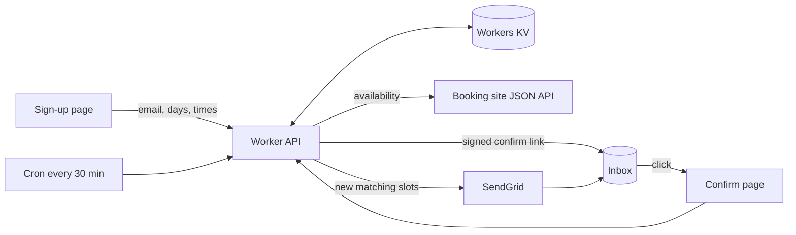

# Tennis Court Notifier

[](https://github.com/Lydia-ivee/tennis-court-notifier/actions/workflows/ci.yml)

A small Cloudflare Worker that watches court availability at Highbury tennis centre and emails you when a slot opens that matches the days and times you picked.

**Built in July 2026.** This repo was published to GitHub on 22 November 2026. The first commit dates (7 and 8 July 2026) are the files' last-modified times from when I built it, not the date it was uploaded.

## How it works



1. People sign up on a static page with their email, weekdays and hours.
2. The Worker emails a **signed confirmation link**. Nothing is saved until it is clicked (double opt-in).
3. Every 30 minutes a cron trigger asks the booking site's JSON endpoint about the next seven days, only for weekdays someone actually wants. The booking page is a single-page app, so the slots are not in its HTML and there is nothing to scrape.
4. Each subscriber gets one email per **new** matching slot. Slots already emailed are remembered, so nobody gets the same alert every half hour.
5. Every alert ends with **Settings · Pause for a week · Turn off**. The settings page has an on/off switch, a one-week snooze that lapses by itself, in-place editing of days and hours, and a delete button. Alerts also carry one-click unsubscribe headers (RFC 8058).
6. The sign-up page shows when the courts were last checked and how many slots were open, from an anonymous status record each run writes.

## Project layout

```
src/
  index.js          router and cron entry point
  subscriptions.js  sign-up, confirm, manage and unsubscribe handlers
  check.js          the scheduled availability check
  availability.js   London-time dates, booking API client with retry and backoff
  matching.js       pure matching, de-duplication and pause logic
  email.js          email templates (HTML-escaped) and the SendGrid client
  tokens.js         HMAC-signed, purpose-bound tokens
  validation.js     input allowlists
  http.js           JSON responses, errors, masked logging
public/             sign-up, confirm and settings pages, plus security headers (_headers)
test/               Vitest suites with an in-memory KV and stubbed fetch
```

## API

| Method   | Path                         | Auth                  | Purpose                              |
| -------- | ---------------------------- | --------------------- | ------------------------------------ |
| `POST`   | `/api/subscriptions`         | none (rate limited)   | Request alerts, sends a confirm link |
| `POST`   | `/api/subscriptions/confirm` | confirm token in body | Activate or replace a subscription   |
| `GET`    | `/api/subscription`          | `Bearer` manage token | Read your preferences                |
| `DELETE` | `/api/subscription`          | `Bearer` manage token | Stop your alerts                     |
| `POST`   | `/api/unsubscribe?token=...` | manage token in query | One-click unsubscribe from mail apps |

## Run it

You need Node 20 or later, a Cloudflare account and a SendGrid API key.

```sh
npm install
cp wrangler.example.toml wrangler.toml   # fill in account ID, KV namespace ID and PUBLIC_URL
cp .dev.vars.example .dev.vars           # local secrets for `npm run dev`
npm run dev
```

To deploy, set the three secrets once and deploy:

```sh
npx wrangler kv namespace create PREFERENCES   # paste the id into wrangler.toml
npx wrangler secret put SENDGRID_API_KEY
npx wrangler secret put FROM_EMAIL
openssl rand -base64 48 | npx wrangler secret put TOKEN_SECRET
npm run deploy
```

## Develop

```sh
npm test              # unit and integration tests
npm run coverage      # with a coverage report
npm run lint          # ESLint
npm run format        # Prettier
npm run check         # everything CI runs
```

CI runs lint, formatting, tests with coverage, `npm audit` and a dry-run Worker bundle on every push and pull request.

## Security

See [SECURITY.md](SECURITY.md) for how subscribers are protected and how to report a problem.

## Limits

- It depends on an undocumented booking endpoint that can change without notice.
- It checks every 30 minutes, so a slot can be gone before the email lands.
- Be kind to the booking site: dates are fetched one at a time and only when someone wants them.

## Licence

[MIT](LICENSE)
